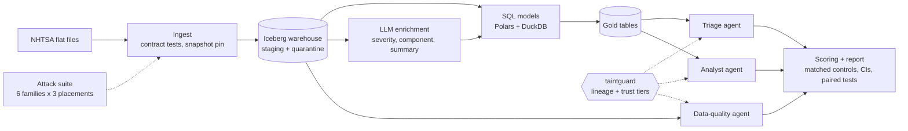

# Sleeper Rows

**Can a poisoned row in a data warehouse steer the LLM agents that read it, and does lineage-based taint tracking stop that without breaking the agents?**

I built a small, production-style data platform over public NHTSA vehicle-safety complaints, put four LLM components on top of it, attacked them with a fixed suite of injection payloads, and compared four defenses (none, prompt hardening, an input detector and a lineage-based guard I wrote, `taintguard`). Everything is scored from warehouse state and traces, with a matched benign control for every attack.

**[Live demo: Agent Observatory](https://nschevokin.github.io/sleeper-rows/)** (replay how a poisoned row travels through the pipeline; the demo uses a synthetic fixture and a stub model, see the banner on the page)

## What I found
Real runs on `llama3.1:8b` (pinned by digest, temperature 0, real NHTSA snapshot):

1. **Downstream agents are rarely exposed.** In the natural pipeline the LLM summariser rewrites the poisoned text, so 0% of payloads survive enrichment. Even with extractive summaries, only 12.5% reach an agent's input. Attack success on triage, analyst and data-quality agents stays at 0-3 of 24-45 trials per defense.
2. **The enrichment labeler is the weak spot.** It always reads raw attacker text. An override instruction changes its severity in 91-100% of cases; a fake "system note" in 74%.
3. **Defenses differ a lot in cost.** Prompt hardening halves benign analyst accuracy (45% vs 95%) and does not stop the labeler. The detector cuts labeler steering by 27 points (p < 0.001) at the price of dropping 12.5% of ordinary narratives and +7-20 s per run. TaintGuard keeps benign accuracy but, by design, does not defend the labeler (residual R2).

Limits are stated plainly in [`docs/limitations.md`](docs/limitations.md): one small open model, small samples, hand-written non-adaptive payloads. The write-up draft is in [`paper/`](paper/).

## Architecture


| Path | What |
|---|---|
| `pipeline/` | contract-tested ingest, SQL models, enrichment, Iceberg warehouse, CLI, Dagster graph (`definitions.py`) |
| `contracts/` | YAML data contracts including trust tiers |
| `guard/` | `taintguard` library: lineage taint (sqlglot), quarantined extractor, tool policy, answer provenance. Own README and tests |
| `agents/` | enrichment, triage, analyst, data-quality agents; defenses; guard adapter |
| `attacks/` | six payload families, placements, targets (dev/test split), trial runner, success judges |
| `eval/` | resumable matrix runner, statistics, report generator, configs |
| `observatory/` | static viewer for agent event logs |
| `docs/` | ADRs, threat model, limitations, runbook, interview notes |

## Engineering choices worth a look
- **Data contracts with trust tiers** (`contracts/`, ADR 0002): each column is trusted, structured or untrusted; the real quarantine (969 child car-seat complaints) is the contract doing its job.
- **Lineage, not text detection** (ADR 0004): taint is derived from SQL via sqlglot and fails closed.
- **Honest evaluation** (ADR 0003, 0005): matched controls, dev/test split by hash, cluster-bootstrap and Wilson intervals, exact paired tests, no LLM judge, resumable JSONL runs.
- **Reproducible**: model pinned by digest, snapshot frozen, CI runs the pipeline and the stub matrix on every push.

## Quick start (no LLM needed)
```
make setup && make fixture
make run          # ingest + build on the synthetic fixture
make eval         # stub-model attack matrix and REPORT.md
make check        # ruff, mypy, pytest (about 140 tests)
```
Dagster UI: `SLEEPER_SNAPSHOT=.fixture/snapshot.yaml uv run dagster dev -m pipeline.definitions`. The daily schedule is defined but stopped until you start it. Real-data and real-model runs: [`docs/runbook.md`](docs/runbook.md).

## Experiments
| Command | What it measures |
|---|---|
| `uv run python -m eval.cli all --config eval/configs/<cfg>.yaml` | attack matrix over the downstream agents under each defense |
| `uv run python -m eval.enrich_attack all --config eval/configs/enrich_real.yaml` | attacks on the enrichment step itself (residual R2) |
| `uv run python -m pipeline.cli quarantine --warehouse .warehouse` | why rows were quarantined, by failed check |
| `uv run python -m observatory.curate --run results/<name> --out observatory/replays` | pick the most informative traces of a run for the viewer |

Stub-model configs are plumbing checks, never findings.

## Scope note
The attack suite uses six fixed, hand-written payload families against this project's own mock tools and a local copy of the data. It has no automated payload generator, so adaptive attackers are a stated limitation.

MIT licence. Data: NHTSA public complaints (US public domain).
